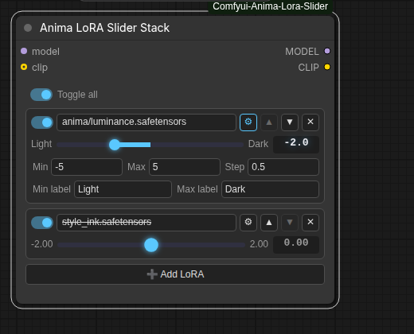

# Anima LoRA Slider Stack

A ComfyUI node that loads any number of LoRAs, like rgthree's **Power Lora Loader**, but every
LoRA gets its own configurable **slider** instead of a plain number field, styled after
**ComfyUI-SimpleFloatSlider**. Good for slider LoRAs (luminance, detail, age, …) where you want
to see at a glance which way each one pushes.



## Install

Clone into `ComfyUI/custom_nodes` and restart ComfyUI:

```sh
cd ComfyUI/custom_nodes
git clone https://github.com/susanoo1337/comfyui-anima-lora-slider.git
```

The node appears as **Anima LoRA Slider Stack** under `loaders`.

## Usage

- Connect `model` (required) and `clip` (optional). Without clip, LoRAs apply to the model only.
- **➕ Add LoRA** opens a searchable list of your `models/loras` files. Add as many as you like.
- Each row has:
  - an **on/off switch**, and the **LoRA name** (click it to pick a different file)
  - **⚙** opens the slider's settings: **Min**, **Max**, **Step**, **Min label** and **Max label**
    (for a luminance LoRA you might use `Light` and `Dark`). Without labels, the ends show the
    min/max numbers.
  - **▲ / ▼** to reorder rows (LoRAs are applied top to bottom), **✕** to remove a row
- Using the slider:
  - drag it, or scroll over it to step by one **Step**
  - click the number to type an exact value (clamped to min/max, not snapped to the step)
  - double-click the slider to reset it to **0**
- **A LoRA whose slider is at 0 is not loaded at all.** Its name is struck through as a reminder.
  Rows that are switched off or have no LoRA picked are skipped as well.
- The slider's step grid is anchored at 0 whenever 0 is inside the range, so you can always
  drag exactly back to 0.
- The same strength is applied to both model and clip.
- **Toggle all** switches every row on or off at once.

New rows start with min `-2`, max `2`, step `0.05` and strength `1`.

Press `R` in ComfyUI (refresh) after adding new LoRA files to update the list.

## Credits

- Dynamic-input approach and LoRA filename matching adapted from
  [rgthree-comfy](https://github.com/rgthree/rgthree-comfy) (MIT, © 2023 Regis Gaughan, III).
- Slider styling adapted from
  [ComfyUI-SimpleFloatSlider](https://github.com/Carasibana/ComfyUI-SimpleFloatSlider)
  (MIT, © 2026 Carasibana).
